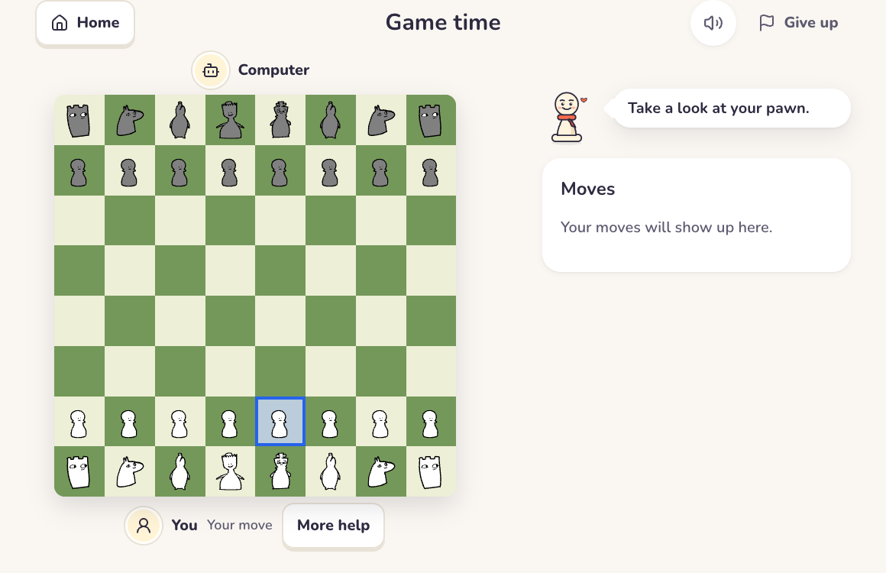

# Pawnpal

Pawnpal is an offline chess coach for kids who already know how the pieces move. Play against eight levels of Stockfish, try a move again with a hint from Pip, and review a few key moments after each game.



## Requirements

- Node.js 22.13 or newer
- A recent Chrome, Edge, Firefox or Safari
- Ollama or another OpenAI-compatible server, only if you want optional coach rephrasing

## Quick start

```sh
npx pawnpal
```

The first run opens your browser. Choose a parent PIN, create a kid profile, and choose a color and level. You can skip the coach-model step and still get hints and explanations from Pip. Guest play is available on the welcome screen.

## Coach rephrasing

Open **Parent settings → Coach brain** to connect a model. In Ollama, start the local server and download the suggested Qwen3 1.7B model using the command shown in the app, then select it. The 1.7B model produced more valid replies and responded faster than the 4B model in the local benchmark. For LM Studio or another OpenAI-compatible server, choose **Use another server** and enter its API base URL, model, and API key if needed. Use **Test** to see an example and its response time before saving. The built-in coach is always available if the model is slow or its answer fails validation. [Measured models](docs/llm-models.md)

## Train Pip locally

Pip's training tools turn Stockfish-checked games into examples of how to explain a chess position to a child. Build the data pipeline from a source checkout.

```sh
npm ci
npm run training:build
```

Start with the offline fixture run to check the pipeline without downloading a model. For a real run, generate self-play games or supply a PGN, grade the positions, and filter candidate replies before splitting the examples by game. [Data pipeline and fixture commands](training/README.md)

Fine-tuning uses MLX on Apple Silicon with Python 3.12. Start with a one-step smoke test, then train the adapter and export local Ollama models. Checkpoints, models, and logs go under the gitignored `training/runs/` directory. [Fine-tuning and export commands](training/py/README.md)

The pilot's trained Q4 passed 99 of 100 held-out cases. The matched untrained model passed 96. The three-point improvement fell short of the 15-point release threshold. [Pilot results](docs/llm-models.md#local-pip-fine-tuning-pilot)

## Tablet play

Keep Pawnpal running on your computer and connect the tablet to the same Wi-Fi. In **Parent settings → Play on other devices**, enable Wi-Fi access and scan the QR code or open the displayed address. On an iPad, use Safari’s **Share → Add to Home Screen** for a full-screen shortcut. To enable Wi-Fi access at startup, run `npx pawnpal --lan`.

## Saved data and privacy

Profiles and games live in the `.pawnpal` folder in your user directory. See **Parent settings → Data and export** for its exact path and PGN downloads. Stop Pawnpal before copying the entire folder for a backup. If you forget the parent PIN, run `npx pawnpal reset-pin` on the computer and set a new one in Parent settings.

Pawnpal has no account or telemetry. Stockfish runs in the browser. If you enable rephrasing, the configured server receives only the chess facts, the built-in wording, the mode, and the age when set. It never receives the profile name, games, or database.

## FAQ

- **The opponent feels too easy or hard.** Pick another named level at game setup. A profile remembers the last choice and can suggest a change after a streak.
- **The coach takes too long.** Try a smaller model in Parent settings or disable model rephrasing to use the instant built-in wording.

## Licenses and credits

Pawnpal uses Stockfish, chess.js and react-chessboard. The project started after reading a parent’s account of building a chess coach. [Stockfish.js](https://github.com/nmrugg/stockfish.js) · [chess.js](https://github.com/jhlywa/chess.js) · [react-chessboard](https://github.com/Clariity/react-chessboard) · [Inspiration](https://www.superlinear.academy/c/share-your-projects/63d613)

Pawnpal’s code is licensed under GPL-3.0. The default horsey pieces by cham and michael1241 use a separate CC BY-NC-SA 4.0 license. For a commercial distribution, switch the default piece set to the included cburnett or Pawnpal set in the board component and remove the horsey assets and copies from the build. [Artwork license](design/assets/pieces/horsey/LICENSE.md) · [Piece sets](design/README.md) · [Third-party notices](THIRD_PARTY_NOTICES)

See [CONTRIBUTING.md](CONTRIBUTING.md) for local development and fixtures.
